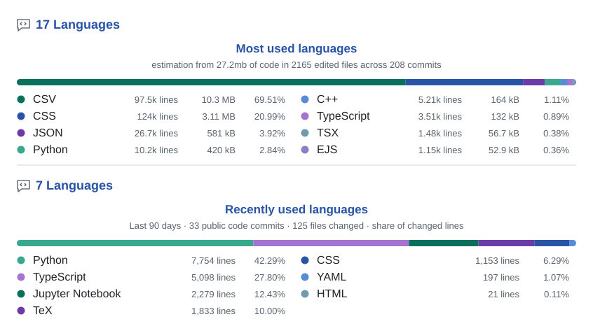

<!-- GitHub profile README — cristinadianas -->

  

  <h2>Hi there, I'm Cristina! 👋</h2>
  

    💼 <strong>IT Data Analyst @ Procter &amp; Gamble</strong> 
    📖 <strong>MSc Student in Artificial Intelligence</strong> at POLITEHNICA University of Bucharest 
    🎓 <strong>BSc in Computers and Information Technology</strong> from the University of Bucharest
  

   

  <picture>
    <source
      media="(prefers-color-scheme: dark)"
      srcset="https://readme-typing-svg.demolab.com?font=Fira+Code&amp;weight=500&amp;size=18&amp;pause=1500&amp;center=true&amp;vCenter=true&amp;width=600&amp;height=40&amp;color=B9A4FF&amp;lines=I+learn+by+building;Half+code%2C+half+wires;Powered+by+curiosity;Asking+questions%2C+mostly+to+data;Train%2C+test%2C+tinker;Low+loss%2C+high+curiosity;Turning+%E2%80%9Cwhat+if%E2%80%9D+into+a+repo;One+more+feature%2C+then+I%E2%80%99ll+sleep"
    />
    
  </picture>

<h2>🕵 About me</h2>

  I enjoy taking an idea from the first experiment to something I can use, whether that means training a model, automating a workflow, or building with a Raspberry Pi.

  <dl>
    <dt>
      💼☕ <strong>Work:</strong>
    </dt>
    <dd>
      At Procter & Gamble, I develop apps and dashboards that help purchasing teams make data-driven decisions by analyzing forecasts, benchmarking prices, and 
      identifying savings opportunities. I also build internal tools that streamline pricing data ingestion and automate manual workflows for my team.
    </dd>
    <dt>
      🎓💡 <strong>Education:</strong>
    </dt>
    <dd>
      I’m pursuing a master’s in Artificial Intelligence at POLITEHNICA University of Bucharest after completing my bachelor’s in Computers and Information Technology 
      at the University of Bucharest. For my bachelor’s thesis, I adapted a deep learning model to brain tumor segmentation using multiple MRI modalities. The thesis 
      earned a 10/10, and the research was presented at SYNASC 2026.
       
      
    </dd>
    <dt>
      🧠🌱 <strong>Interests:</strong>
    </dt>
    <dd>
      I’m especially interested in data analysis, deep learning, and computer vision. I enjoy finding patterns in data, exploring how they 
      shape what models learn, and evaluating and interpreting model predictions. I keep up with SOTA research and enjoy seeing how advances 
      in AI translate into real-world applications. 
    </dd>
    <dt>
      🛠️🔬 <strong>What I like building:</strong>
    </dt>
    <dd>
      I like having a side project to tinker with, too. Lately, I’ve been building projects with Raspberry Pi, experimenting with 3D printing, and exploring game 
      development in Unreal Engine 5. I also build little tools for myself, like custom software to control my PC lights.
    </dd>
    <dt>
      🎵🏎️ <strong>Hobbies:</strong>
    </dt>
    <dd>
      I’m a little competitive with myself, which probably explains why I love chasing a faster lap in karting and coming back to a bouldering route until I figure 
      it out. At home, I like playing piano and hearing a piece slowly come together. And I’m always up for a movie 
      night or a good book.
    </dd>
  </dl>

<h2>💻 Tech stack</h2>

  &ensp;
  
  
  
  
  
  

  &ensp;
  
  
  
  
  
  
  
  
  

  &ensp;
  
  
  
  
  
  
  
  
  
  

  &ensp;
  
  
  
  
  
  
  
  

  &ensp;
  
  
  
  
  
  
  
  
  
  

  &ensp;
  
  
  

<h2>📈 GitHub activity</h2>

  <picture>
    <source
      media="(prefers-color-scheme: dark)"
      srcset="./assets/contributions.dark.svg"
    />
    
  </picture>

<h2>🌐 Language usage</h2>

  <picture>
    <source
      media="(prefers-color-scheme: dark)"
      srcset="./assets/languages.dark.svg"
    />
    
  </picture>

  <h3>Let's connect! 🤜🤛</h3>
  

    I'm always interested in new ideas, technical challenges and opportunities
    to learn.
  

  &nbsp;
  

